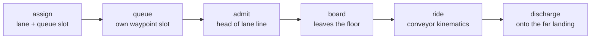

# Escalators

An escalator is a **conveyor** between two floor simulations, not walkable
floor. While riding, a person is on no floor at all. They step off the belt
onto the other level's landing.

1. **Assign.** Choosing an escalator gives the person a lane (walk, with
   probability `walk_share`, otherwise stand) and a queue slot on the
   boarding landing.
2. **Queue.** Everyone waits at their *own* waypoint, so no two people
   converge on one point. The earliest arrivals stand in a short line per lane
   in front of the comb; later ones take overflow slots spread over the
   landing, nearest first. An apron in front of the comb is kept clear.
3. **Admit.** When the belt has room in a lane, the head of that lane's line
   walks onto the boarding strip.
4. **Board.** JuPedSim removes them at the strip and they join the conveyor.
5. **Ride.** Standers move at belt speed, one per step, often leaving a step
   free (`stander_step_gap_prob`). Walkers add their own climbing pace, never
   overtake, and keep a free step to the walker ahead. Nothing on the belt can
   block anything else, so the conveyor itself cannot gridlock.
6. **Discharge.** At the far comb they are placed on the landing with their
   own walking speed, heading for the escalator's egress point. If the
   landing is full the belt **pauses** until there is room. Nobody is sent
   back.

**Closing** an escalator (a `block_exit` event):

- Boarding stops and the queue is released; those people decide again.
- Riders already on the belt finish their ride.
- Someone who reaches the strip as it closes is put back on the landing to
  decide again.
- People who choose a closed escalator they cannot see walk to it, find it
  closed, and decide again.

Geometry: each escalator's combs are `jupedsim.escalator_comb` records in the
level XML files. Parameters: `simulation.escalators` (defaults and
per-escalator overrides). Outputs:

- `escalator_log.csv`: one row per ride, with queue, board and alight times;
- `escalators.json`: the geometry;
- an `escalators` key in each frame of `frames.jsonl`.

Why this design: [ADR 1](../adr/0001-conveyor-escalators.md).
