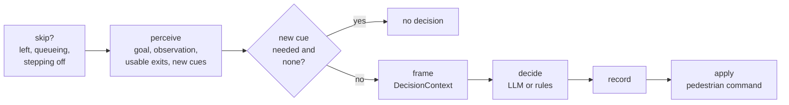

# How a run works

A run has three layers that move at different speeds:

| Layer | What it does | How often |
|---|---|---|
| **Physics** | JuPedSim moves everyone towards their current target | every step (`simulation.dt`, typically 0.05–0.1 s) |
| **Events and staff** | alarms, PA announcements, trains, closures; staff move and speak | every step, at the scheduled times |
| **Decisions** | each person chooses what to do next | in cycles (`simulation.decision_interval`), sooner when something happens |

Physics never waits for a decision. A person keeps walking to their last
target until a new decision changes it.

## One step

`HybridSimulationRunner._run_step` runs these in order:

1. **Arrivals.** In calibration runs, passengers due now enter (from the
   street or off a train).
2. **Physics.** One JuPedSim step on every level, then escalator conveyors
   ([Escalators](escalators.md)).
3. **Exits.** People who left through a street exit, or boarded a dwelling
   train, are recorded in `exit_log.csv`.
4. **Who must decide now.** People who just changed level or were turned back
   at a closed route are queued for an immediate decision. So is anyone the
   [progress watchdog](../adr/0005-progress-watchdog.md) has just stepped
   aside.
5. **Staff.** Staff agents move (hold or patrol) and speak their directives
   to people nearby ([Events, cues and staff](events-and-staff.md)).
6. **Events.** Scheduled events fire: the alarm, PA announcements, trains
   arriving and leaving, exits closing.
7. **Decision cycle**, when one is due (below).
8. **Record.** Position frames every 0.5 s of simulated time, zone
   populations, and the live-viewer file.

## A decision cycle

People decide in staggered groups so that not everyone decides in the same
step. A critical event (an exit closing, a train leaving) makes everyone
decide at once. In each cycle, `DecisionProcessor` does the following:

The first four boxes (perceive to decide) run for **all** deciding people
before any decision is applied, concurrently for the LLM engine. Every
decision in a cycle is therefore made from the same state of the world.
Recording and applying then happen person by person in a fixed order, so a
run is reproducible however the network calls finish
([ADR 4](../adr/0004-decide-then-apply.md)).

**Perceive** and **frame** (`evacusim.decision.situation`) produce the
`DecisionContext` that both engines receive:

- the person's goal and natural-language observation;
- the **offered actions**: `continue_activity`, `wait`, `seek_information`
  (if staff or other information is reachable), `evacuate` (if any exit is
  offered), `leave_by_train` (if a train is dwelling);
- the **offered exits**: those the person knows from their profile, can see,
  or has been told about. Each comes with routing signals: route length,
  visibility, crowding and familiarity;
- the cues perceived since the last decision.

**Decide**: see [Decision engines](decision-engines.md).

**Apply** (`ActionExecutor`) turns the decision into a pedestrian command:

- a journey to an exit;
- a waypoint (seek information, wait in place);
- a speed change for the chosen pace.

A person who leaves no longer decides. A person queueing for an escalator, or
still stepping off one, is skipped until they are clear.

## Ending

A run ends after `simulation.max_iterations` steps, or when everyone has left
and no arrivals are due. A physics failure raises `SimulationError` with
everything simulated so far saved, and the manifest records the run as
`failed`. Ctrl-C ends the run at the current step and saves it as
`interrupted`.
