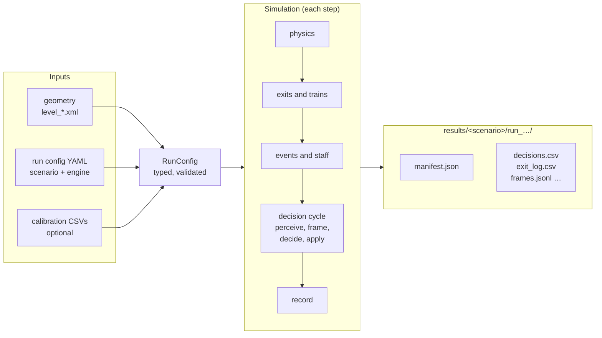

# evacusim

evacusim simulates people evacuating a building, most often a metro station.
Pedestrian movement comes from [JuPedSim](https://www.jupedsim.org/). What
each person decides to do comes from one of two **decision engines**:

- **`llm`**: a language model reads what the person can see and hear and
  chooses an action (through [Concordia](https://github.com/google-deepmind/concordia)
  agents).
- **`rule_based`**: deterministic rules. People respond to warnings after a
  delay set by how strong the warning was, then take the best route out.

Both engines see the same situation and return the same kind of decision, so
a scenario can be run with either and the results compared.

The engine is not tied to one venue. A **study repository** supplies the
geometry, the scenarios and the analysis. The reference study, Monument
station in Newcastle re-running Proulx's 1991 evacuation drills, is
[monument-evacuation](https://github.com/MJones235/monument-evac-sim).

## The flow of a run

1. **Inputs.** The station geometry, and one YAML configuration that may
   `extends:` others (a base, a scenario, an engine overlay).
2. **Parameters.** The YAML is validated against a typed schema
   ([Parameters](parameters.md)). An unknown or mistyped key is an error, and
   every default lives in one place.
3. **Simulation.** Physics runs every step. Decisions are made in cycles. See
   [How a run works](concepts/how-a-run-works.md).
4. **Outputs.** One directory per run, starting with a `manifest.json` that
   records exactly what produced it ([Outputs](outputs.md)).

## Where to read next

- [Getting started](getting-started.md): install and run.
- [Decision engines](concepts/decision-engines.md): what each engine does,
  and where they differ.
- [Design decisions](adr/index.md): why the code is shaped as it is.
- [API](api/decision.md): the code, generated from its docstrings.
